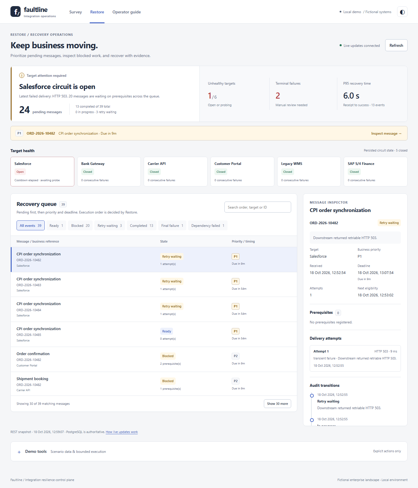

# Faultline

**An integration resilience control plane for SAP-style enterprise landscapes.**

Faultline is a portfolio-grade, local-first system that answers two operational questions during an integration failure:

1. What business systems and CPI-style flows are affected, and what should recover first?
2. How can failed events be replayed safely without violating dependencies or overwhelming an unhealthy target?

It contains two complementary backend modules and one operator dashboard. The operator connects Survey's landscape assessment to Restore's recovery work; creating a report does not automatically enqueue messages.

| Component | Responsibility |
|---|---|
| `survey` | Models the landscape as a directed graph and produces impact/recovery reports. |
| `restore` | Performs durable, dependency-aware retry orchestration. |
| `dashboard` | A Next.js operational view of the backend’s real data and scenarios. |

## Status

Survey is a complete, containerised impact-analysis module. Restore now has durable event intake, dependency-aware release and terminal-failure propagation, worker leases, bounded retries with jittered exponential backoff, persisted target circuits, queryable attempt history and aggregate statistics, a controllable downstream simulator, timeout-bound HTTP execution, opt-in automatic batch scheduling, repeatable scenarios, and an assertion-driven 50,000-event recovery benchmark. Restore now also emits post-commit SSE live-state notifications, and the dashboard exposes its queue, statistics, circuits, event evidence, and scenario controls; the polished Survey incident workspace, Restore operations console and five-minute operator guide are included in both light and dark themes. The public design baseline is available in [`docs/planning`](docs/planning).

No real SAP, CPI, Salesforce, customer data, or credentials are used. All demo systems and payloads are fictional and run locally.

## Public design documents

- [Suite overview and delivery plan](docs/planning/suite-overview.md)
- [Survey module design](docs/planning/survey-module.md)
- [Restore module design](docs/planning/restore-module.md)
- [Restore 50,000-event benchmark](docs/technical/restore-recovery-benchmark.md)
- [Restore delivery and ordering contract](docs/technical/restore-delivery-ordering.md)
- [Restore terminal-failure contract](docs/technical/restore-terminal-failures.md)
- [Restore live-update contract](docs/technical/restore-live-updates.md)
- [Restore circuit probes and crash recovery](docs/technical/restore-circuit-probes.md)
- [API security and downstream credentials](docs/technical/api-security.md)
- [Learning path through the existing documents](docs/learning-path.md)
- [Survey case study](docs/case-studies/survey.md) and [Restore case study](docs/case-studies/restore.md)
- [Release verification and current evidence](docs/worklog/2026-10-18-release-readiness.md)

## Local development policy

The repository will contain production-style source, tests, architecture/design material, sample data, and public demo evidence. Personal interview preparation, detailed learning notes, and scratch material live in the Git-ignored `private/` directory so they are not published accidentally.

## Implemented stack

Java 21+, Spring Boot, Maven, PostgreSQL, Flyway, Next.js, TypeScript, Docker Compose, JUnit, PostgreSQL Testcontainers, Playwright, and GitHub Actions. See [development and verification instructions](CONTRIBUTING.md).

## Run Faultline locally

```powershell
if (-not (Test-Path .env)) { Copy-Item .env.example .env }
# Choose a local FAULTLINE_API_KEY in .env before starting.
docker compose --env-file .env -f infra/compose.yaml up --build
```

Open the operator dashboard at `http://localhost:3000`. Survey listens on `http://localhost:8081` ([contract](docs/api/survey-openapi.json)); Restore listens on `http://localhost:8082` ([contract](docs/api/restore-openapi.json)). Both expose JSON at `/v3/api-docs`. Supplied Compose ports bind to localhost. Direct API mutations require `X-Faultline-Api-Key`; the dashboard injects it on the server. The dashboard has no user login and is intended for local use. Automatic Restore delivery is disabled by default; set `RESTORE_WORKER_ENABLED=true` only when that process should execute eligible queue data.

Run the isolated recovery benchmark with `./scripts/benchmark-restore.ps1 -Port 19083` when the operations demo already occupies 18082. It defaults to 50,000 events and removes only its dedicated containers and database volume after verification. Set the shell's `FAULTLINE_API_KEY` when selecting a non-default benchmark credential; the benchmark passes it to its service and HTTP clients.

## Curated operations walkthrough

Use the [isolated operations demo](docs/worklog/2026-09-17-operations-demo.md) for the 39-message Salesforce outage narrative on port 3002. It has a separate PostgreSQL volume and keeps the existing development database intact. Automatic delivery remains disabled; recovery is manual and bounded.

## Operations console

The dashboard focuses on incident exposure and recoverable business work, with a topology inspector, backend-ranked recovery assessment, counted queue filters, message-level evidence and separately confirmed demo tools. The curated scenario uses real HTTP execution and PostgreSQL evidence rather than fabricated metrics.



Watch the [recorded Survey-to-recovery walkthrough](docs/evidence/2026-10-18/faultline-walkthrough.webm), then inspect the [verified final state](docs/evidence/2026-10-18/restore-after.png).

See the [visual and interaction verification](docs/worklog/2026-09-18-console-qa.md) for dark-theme, topology and guide captures, browser test instructions and data-preservation details.

## Version-one boundaries

Survey performs a declared complete-outage analysis; its healthy topology is not live remote telemetry. Restore executes a fictional HTTP simulator contract and retains terminal failures for investigation; terminal-message redrive is deferred. Delivery is at least once with explicit dependency ordering, and simulator deduplication is process-local. Real SAP/CPI connectivity, multi-user authentication, and hosted production operation are separate scopes. Historical benchmark results describe their recorded revision and environment, not a production capacity guarantee.
